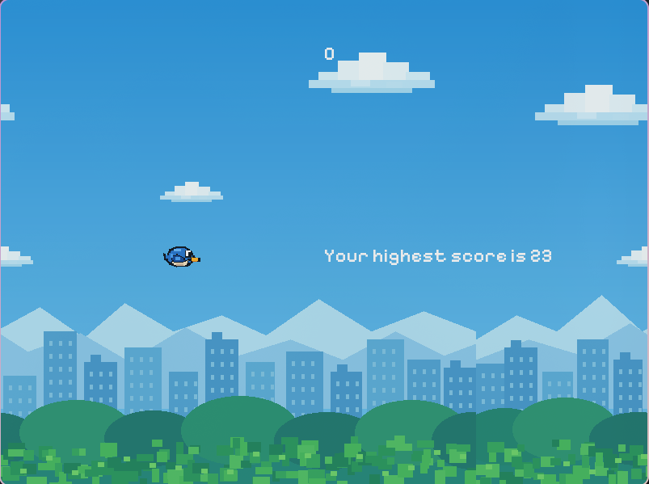
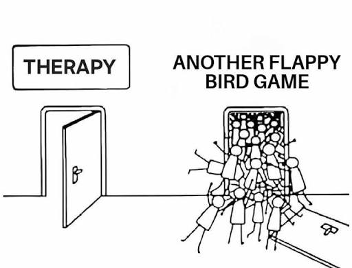

# Tappy Bird
A Flappy Bird clone in C++20 with SFML 3.



## Features:
- gravity and flap physics
- randomly generated pipes
- score counter, saved high score
- animated bird with tilting 
- scrolling background
- game states
- And most important: LOTS OF FUN 

## Controls 

**Space**: flap / start / restart
**Esc**: quit 

## Requirements 
- C++20 Compiler(GCC 12+ or similar)
- CMake 3.x
- SFML 3
- Tested on the best linux distro **Arch**
## Build and run 
```bash
    git clone https://github.com/Tretaq/Tappy-bird
    cd Tappy-bird
    cmake -B build 
    cmake --build build
    ./build/Tappy_bird
```
## Project meme 
